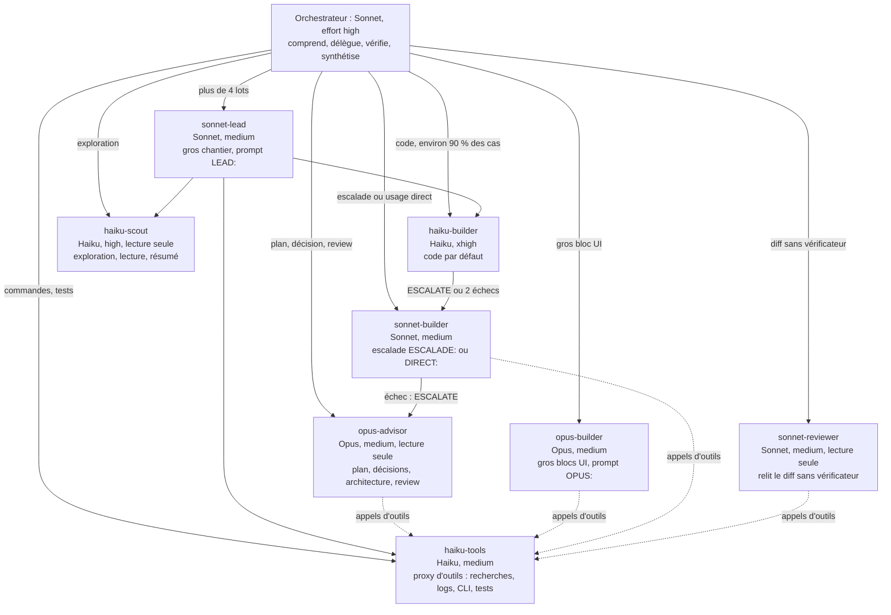
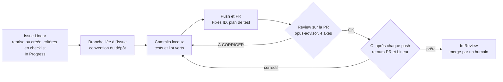

<p align="center"></p>
<p align="center"><sub>Mascotte non officielle.</sub></p>

<p align="center"></p>

**Un graphe d'agents Haiku-first pour Claude Code.** Sonnet orchestre, Haiku écrit la plupart du code, et Opus n'intervient que pour le plan, les décisions, la review et les gros blocs UI. Ce dépôt est le **plugin Claude Code** `gtko-agents` (marketplace `gtko`) : agents, skills et hooks de routage. La configuration complète de mon poste reste dans le dépôt privé `gtko/config`.

## Installation

```bash
claude plugin marketplace add gtko/claude-plugin
claude plugin install gtko-agents@gtko
```

Le dépôt est privé : l'ajout de la marketplace demande un accès GitHub à `gtko/claude-plugin` (identifiants Git ou `gh auth login`).

Les agents et les skills sont préfixés `gtko-agents:` (par exemple `gtko-agents:haiku-builder`).

## Le graphe d'agents



Règles de graphe : les agents Haiku ne délèguent jamais ; `sonnet-builder`, `sonnet-reviewer` et les `opus-*` ne délèguent qu'à `haiku-tools` ; la profondeur maximale est de deux niveaux. Escalade : `haiku-builder` (ESCALATE ou deux échecs), puis `sonnet-builder` (`ESCALADE:`), puis une relance unique en effort high, puis `opus-advisor`.

## Hooks

Le plugin branche quatre événements sur `hooks/dispatch.js` (`hooks/hooks.json`), qui exécute les modules ci-dessous dans l'ordre. Un refus (`exit 2`, `permissionDecision: deny`) arrête la suite. Chaque module est fail-open : une erreur interne ne bloque pas Claude Code.

| Événement | Fichier | Rôle | Interrupteur d'urgence |
|---|---|---|---|
| `SessionStart` | `hooks/handoff.js` | Réinjecte la passation du projet ; avertit si la session ne tourne pas sur Sonnet (via `model-check.js`) | `HANDOFF=off` ; `MODEL_CHECK=off` (dans `model-check.js`) |
| `UserPromptSubmit` | `hooks/model-router.js` | Rappel de routage, une fois par session (revient après un compactage) | aucun |
| `UserPromptSubmit` | `hooks/context-budget.js` | Mesure le contexte : délégation à 200k, passation à 300k, blocage à 400k tokens | `CONTEXT_BUDGET=off` |
| `PreCompact` | `hooks/pre-compact.js` | Écrit ou rafraîchit la passation avant un compactage | `HANDOFF=off` |
| `PreToolUse` (`Agent`) | `hooks/routing-guard.js` | Refuse les sous-agents hors graphe : agent générique, modèle Opus hérité, ou prompt sans `ESCALADE:`, `DIRECT:`, `OPUS:` ou `LEAD:` là où il est exigé | aucun |
| `PreToolUse` (`Bash`, `PowerShell`) | `hooks/heavy-gate.js` | Limite les suites lourdes lancées en parallèle (4 suites, 40 processus node) | `HEAVY_GATE=off` (env ou commande) |
| `PreToolUse` (`Bash`, `PowerShell`) | `hooks/process-gate.js` | Refuse commit ou PR hors process (identifiant d'issue Linear dans la branche et la PR), tout merge par l'agent, `gh pr merge` ou `gh api …/merge` (merge humain, `processGate.agentMerge`), et un déploiement hors de `main` à jour | `PROCESS_GATE=off` |
| `PreToolUse` (tous les outils) | `hooks/tool-guard.js` | Budget d'appels par agent, anti-boucle, lectures trop larges, commandes destructrices refusées | `TOOL_GUARD=off` (tout) ; `DENY_LIST=off` (commandes destructrices seulement) |

Les interrupteurs sont des variables d'environnement à la valeur `off`, par exemple `$env:PROCESS_GATE = 'off'` en PowerShell.

## Process de livraison



- Tout changement de code ou de config suit ce process (skill `livraison`, règles Dotworld). Une question, une lecture ou une édition d'une ou deux lignes n'en relève pas.
- L'issue Linear est cherchée avant d'être créée (pas de doublon), passée `In Progress` avant la première édition, et `In Review` quand la PR est prête. Un bug hors périmètre part dans une issue séparée.
- Après l'ouverture de la PR : CI consultée après chaque push (échec d'infrastructure relancé sans toucher au code), branche à jour avec la base, commentaires de la PR et de l'issue Linear traités (correctif et réponse, ou contestation argumentée d'une suggestion contraire à la spec).
- La review, faite sur la PR par opus-advisor (sonnet-reviewer en voie rapide) et postée sur la PR, couvre quatre axes : **BUG**, **SECURITY**, **UX/UI** et **PERFORMANCE / COÛT**. Tout changement UI passe d'abord par `/design`.
- Voie rapide : un petit diff (30 lignes au plus, hors chemins sensibles) peut être relu par `sonnet-reviewer`, avec le marqueur `<!-- review-rapide -->` et une ligne `Tests :`.
- `process-gate.js` refuse un `git commit` sur `main` ou sur une branche sans identifiant d'issue Linear (`linear.teamKey` du contrat `.claude/dw.json` s'il existe), tout `gh pr merge` lancé par l'agent (un humain merge ; `processGate.agentMerge: true` en surcharge locale pour déléguer, et alors review `<!-- review-4-axes -->` postérieure au dernier commit et checks verts exigés), et tout déploiement hors de `main` à jour.

## Agents

| Agent | Modèle | Effort | Rôle | Dans le plugin |
|---|---|---|---|---|
| `opus-advisor` | Opus | medium | Plan, décisions, architecture, review de PR sur 4 axes (lecture seule) | oui |
| `opus-builder` | Opus | medium | Gros blocs UI et landing pages (prompt `OPUS:`) | oui |
| `haiku-builder` | Haiku | xhigh | Développeur par défaut : tout ce qui produit du code | oui |
| `haiku-scout` | Haiku | high | Exploration, lecture, résumé (lecture seule) | oui |
| `haiku-tools` | Haiku | medium | Proxy d'outils : recherches larges, logs, CLI, tests, éditions mécaniques | oui |
| `sonnet-reviewer` | Sonnet | medium | Relit le diff quand il n'y a pas de vérificateur automatique : OK ou À CORRIGER | oui |
| `sonnet-builder` | Sonnet | medium | Escalade (`ESCALADE:`) ou usage direct justifié (`DIRECT:`) | oui |
| `sonnet-lead` | Sonnet | medium | Second orchestrateur des gros chantiers (`LEAD:`) | oui |
| `fr-reviewer` | Sonnet | medium | Review de code, rapports en français | non |
| `implementer` | Sonnet | medium | Implémentation d'un plan existant | non |
| `linear-planner` | Sonnet | medium | Découpage d'une demande en sous-tâches Linear | non |

## Config complète : dépôt gtko/config

Ce plugin ne contient que les agents, les skills et les hooks. La configuration complète du poste (CLAUDE.md global, settings.json, serveurs MCP, applications, réglages Windows et macOS, fond d'écran du dojo) vit dans le dépôt privé `gtko/config`, qui s'appuie sur ce plugin.

## Sécurité et licence

- **Aucun secret dans le dépôt.** La publication refuse tout fichier qui contient un motif de secret (clés, jetons, `Bearer`) ou un fichier personnel (`settings.json`, `memory/`, `.env`, identifiants).
- **Licence.** Aucune licence n'est déclarée (pas de fichier `LICENSE`) : demandez l'accord de l'auteur avant toute réutilisation.

<p align="center"><sub>Dépôt généré depuis <code>gtko/config</code> par <code>scripts/publish-plugin.ps1</code> : ne pas le modifier à la main.</sub></p>
